 

 

 

---

 

## About

I focus on web application development, embedded IoT systems, and container-based deployment automation.

- **Philosophy:** *"Kenapa ribet kalo bisa pake docker?"*

## Tech Stack

 

## GitHub Stats

<table>
  <tr>
    <td align="center" width="50%">
      
    </td>
    <td align="center" width="50%">
      
    </td>
  </tr>
  <tr>
    <td colspan="2" align="center">
      
    </td>
  </tr>
</table>

 

## Connect

 
 

